<p align="center">
  
</p>

<p align="center">
  
</p>

<p align="center">
  <a href="https://github.com/Deinick">
    
  </a>
</p>

<p align="center">
  
</p>

---

### 🪐 Current Mission

```text
> Pilot ......... Deinick
> Rank .......... Cadet → Starpilot (in progress)
> Home system ... Vancouver, edge of the Pacific
> Now building .. <your current project here>
> Learning ...... <what you're studying>
> Side .......... light side by day, dark side during merge conflicts
```

### ⚔️ Arsenal (Tech Stack)

<!-- To change the blades: edit STACK in scripts/make_assets.py, then run
     python3 scripts/make_assets.py and commit assets/energy-blades.svg -->
<p align="center">
  
</p>

### 📊 Holo-Terminal

<!-- Regenerated every 12 hours by .github/workflows/space-battle.yml from live GitHub data -->
<p align="center">
  
</p>

### 🛸 My Fleet

<!-- Pin your best repos on your profile too. Swap these for your own projects. -->
| Ship | Mission |
|------|---------|
| [`hyperdrive-cli`](https://github.com/Deinick) | Jump between projects at lightspeed |
| [`holocron-notes`](https://github.com/Deinick) | My archive of everything I learn |
| [`robo-helper`](https://github.com/Deinick) | A helper bot that beeps back |

### 🌌 Space Battle (Contribution Graph)

<p align="center">
  <picture>
    <source media="(prefers-color-scheme: dark)" srcset="https://raw.githubusercontent.com/Deinick/Deinick/output/space-battle-dark.svg"/>
    <source media="(prefers-color-scheme: light)" srcset="https://raw.githubusercontent.com/Deinick/Deinick/output/space-battle-light.svg"/>
    
  </picture>
</p>

### 📡 Comms Array

<!-- Add your links, e.g.:
<a href="https://linkedin.com/in/YOUR-ID"></a>
<a href="mailto:you@example.com"></a>
-->
<a href="https://github.com/Deinick?tab=followers"></a>

---

<p align="center"><i>"No bug survives the hyperspace jump."</i><br/>⭐ Stars fuel the hyperdrive. Fly safe, and ship often.</p>

<sub>Fan-inspired original design, not affiliated with or endorsed by Lucasfilm or Disney. Credits & licenses: <a href="./CREDITS.md">CREDITS.md</a>.</sub>
